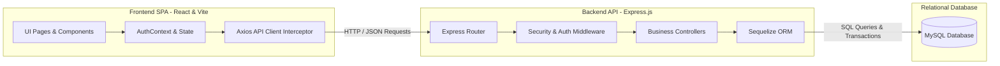
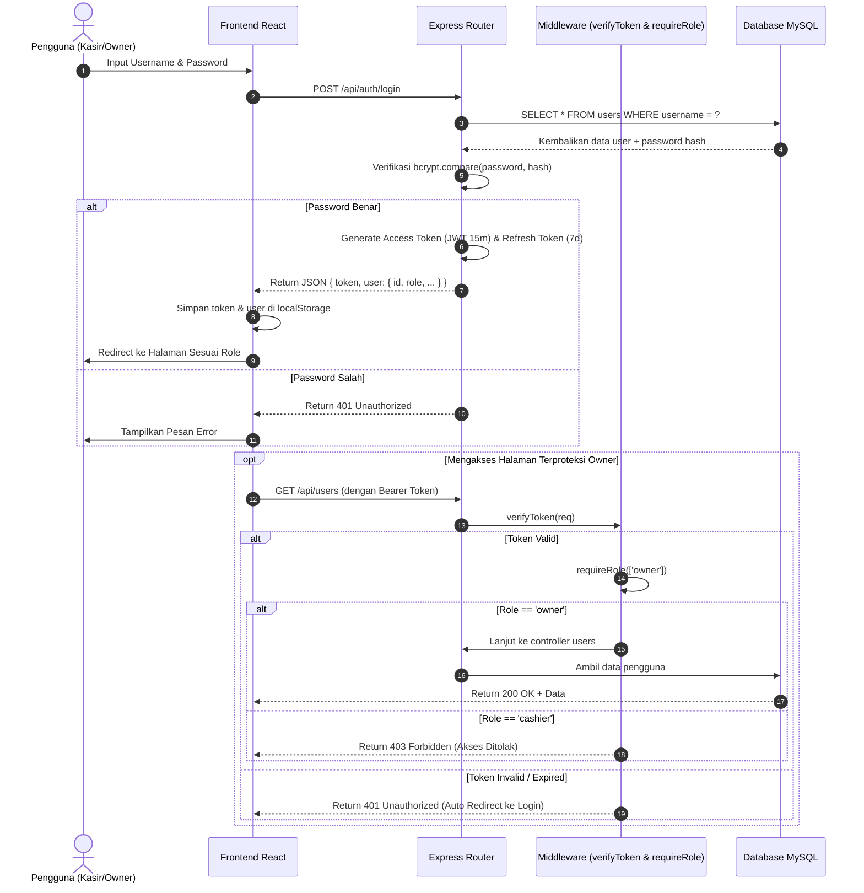
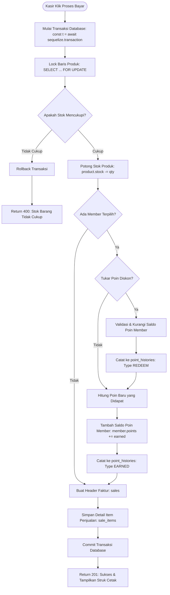
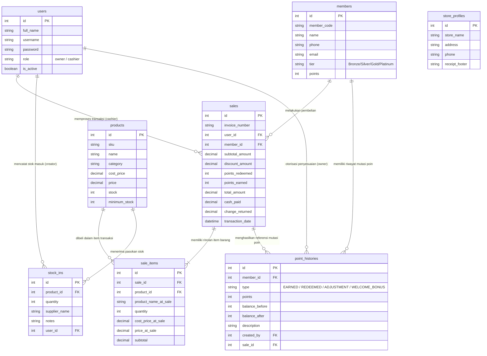

# ⚙️ Bagian 2: Alur Kerja Fitur & Sistem (System & Architecture Workflows)

Dokumen ini menjelaskan arsitektur perangkat lunak, aliran data antar-komponen, logika bisnis inti, serta skema basis data relasional yang menopang seluruh operasional **Proyek P01**.

---

## 📑 Daftar Isi
1. [Arsitektur Tingkat Tinggi (High-Level Architecture)](#1-arsitektur-tingkat-tinggi-high-level-architecture)
2. [Alur Autentikasi JWT & Role-Based Access Control (RBAC)](#2-alur-autentikasi-jwt--role-based-access-control-rbac)
3. [Alur Transaksi Kasir POS (Transaksi Atomik & Kunci Baris)](#3-alur-transaksi-kasir-pos-transaksi-atomik--kunci-baris)
4. [Alur Program Loyalty Member & Mutasi Poin](#4-alur-program-loyalty-member--mutasi-poin)
5. [Alur Pengelolaan Inventori & Stok Masuk](#5-alur-pengelolaan-inventori--stok-masuk)
6. [Skema & Relasi Database (Entity Relationship)](#6-skema--relasi-database-entity-relationship)

---

## 1. Arsitektur Tingkat Tinggi (High-Level Architecture)

Aplikasi dibangun menggunakan pola arsitektur **Client-Server Terpisah (Decoupled Single Page Application & RESTful API)**:



### Prinsip Aliran Data:
1. **Frontend (Port 5173):** Komponen React menangkap interaksi pengguna $\rightarrow$ memicu fungsi pengiriman data melalui `apiClient` (Axios).
2. **Network Transport:** Request dikirim melalui HTTP dengan header `Authorization: Bearer <token_jwt>`.
3. **Middleware Backend (Port 5000):** Memeriksa keamanan (Helmet, Rate Limiting, CORS) dan memvalidasi keabsahan token JWT serta level hak akses peran (*Role*).
4. **Controller:** Menjalankan logika bisnis (validasi kuantitas stok, transaksi atomik, kalkulasi poin).
5. **Sequelize ORM:** Mengonversi perintah JavaScript menjadi kueri SQL relasional yang aman dari celah *SQL Injection*.
6. **Database MySQL:** Menyimpan data secara persisten dan konsisten.

---

## 2. Alur Autentikasi JWT & Role-Based Access Control (RBAC)

Sistem membedakan dua tingkatan peran dengan hak akses tegas:
- **`owner` (Pemilik Toko):** Memiliki akses ke seluruh endpoint dan antarmuka.
- **`cashier` (Kasir):** Hanya memiliki akses ke endpoint kasir, pencarian member, dan riwayat hari ini.

### Diagram Alir Autentikasi & Otorisasi:



---

## 3. Alur Transaksi Kasir POS (Transaksi Atomik & Kunci Baris)

Proses kasir adalah operasi kritis karena melibatkan perputaran uang dan pemotongan stok barang. Sistem menerapkan **Sequelize Managed Transaction (`t`)** dengan prinsip **ACID (Atomicity, Consistency, Isolation, Durability)**.

### Langkah demi Langkah Eksekusi Atomik di Backend (`checkout`):



### Mengapa Perlu Snapshot Harga Historis (`price_at_sale`)?
Jika suatu produk di kemudian hari dinaikkan harganya oleh pemilik toko (misal: Beras naik dari Rp68.000 menjadi Rp75.000), maka struk dan laporan keuangan transaksi bulan lalu **TIDAK BOLEH BERUBAH**. Karena itu, harga satuan saat transaksi disimpan permanen di kolom `sale_items.price_at_sale`.

---

## 4. Alur Program Loyalty Member & Mutasi Poin

Modul loyalitas member dirancang untuk meningkatkan retensi belanja pelanggan dengan mekanisme poin transparan dan terlacak (*Audit Trail*).

### Rumus & Aturan Bisnis Loyalitas:
1. **Perolehan Poin (*Earn Points*):**
   - Setiap pembelanjaan kelipatan **Rp10.000**, pelanggan memperoleh **1 Poin**.
   - Contoh: Belanja Rp134.000 $\rightarrow$ `Math.floor(134000 / 10000) = 13 Poin`.
2. **Penukaran Poin Diskon (*Redeem Points*):**
   - **1 Poin bernilai potongan Rp100**.
   - Contoh: Menukar 20 Poin $\rightarrow$ Potongan harga langsung **Rp2.000**.
3. **Kenaikan Tingkatan Member (*Tier System*):**
   - **Bronze:** 0 - 99 Poin.
   - **Silver:** 100 - 299 Poin.
   - **Gold:** 300 - 999 Poin.
   - **Platinum:** 1000+ Poin.
4. **Audit Trail Mutasi Poin:**
   Setiap perubahan saldo poin member (baik bertambah karena belanja, berkurang karena ditukar diskon, atau disesuaikan manual oleh owner) **WAJIB** mencatat baris baru di tabel `point_histories` lengkap dengan `balance_before`, `balance_after`, dan `description`.

---

## 5. Alur Pengelolaan Inventori & Stok Masuk

Inventori barang diatur dalam dua arah pergerakan stok:

```
[Supplier] 
     │
     ▼ (Stok Masuk / stock_ins)
[Gudang / Master Produk] ─── (Stok Berkurang / sales) ───► [Pelanggan]
     │
     ▼ (Jika stok <= minimum_stock)
[Peringatan Stok Menipis di Dashboard Owner]
```

1. **Penambahan Stok:**
   - Dibuat melalui menu **Stok Masuk**.
   - Menyimpan data kuantitas, tanggal, nama pemasok (*supplier*), dan catatan.
   - Secara otomatis memperbarui kolom `products.stock` (`stock = stock + qty_masuk`).
2. **Pengurangan Stok:**
   - Terjadi secara otomatis dan real-time saat transaksi kasir di-checkout.
3. **Pendeteksian Stok Kritis:**
   - Kueri Dashboard: `SELECT * FROM products WHERE stock <= minimum_stock`.

---

## 6. Skema & Relasi Database (Entity Relationship)

Database menggunakan 8 tabel utama yang saling terhubung:


