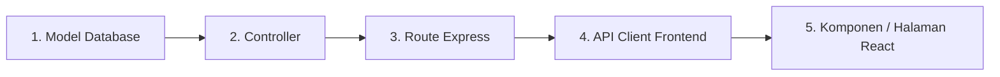

# 💻 Bagian 3: Panduan Belajar Kode Proyek (Developer & Code Learning Guide)

Dokumen ini disusun sebagai kurikulum pembelajaran mendalam bagi **Junior Programmer** dan **Peserta Magang Fullstack Web Developer** untuk membedah baris demi baris arsitektur kode sumber (*source code*) pada **Proyek P01**.

---

## 📑 Daftar Isi
1. [Peta Struktur Direktori Proyek](#1-peta-struktur-direktori-proyek)
2. [Bedah Kode Backend (Express.js & Sequelize)](#2-bedah-kode-backend-expressjs--sequelize)
   - 2.1 [server.js — Gerbang Utama Server](#21-serverjs--gerbang-utama-server)
   - 2.2 [middlewares/auth.js — Satpam Pemeriksa Token & Peran (RBAC)](#22-middlewaresauthjs--satpam-pemeriksa-token--peran-rbac)
   - 2.3 [models/ — Pemodelan Basis Data Relasional](#23-models--pemodelan-basis-data-relasional)
   - 2.4 [controllers/ — Pusat Logika Bisnis & Transaksi](#24-controllers--pusat-logika-bisnis--transaksi)
3. [Bedah Kode Frontend (React, Vite, & Tailwind CSS)](#3-bedah-kode-frontend-react-vite--tailwind-css)
   - 3.1 [src/api/axios.js — Kurir Pengantar Data Berotentikasi](#31-srcapiaxiosjs--kurir-pengantar-data-berotentikasi)
   - 3.2 [src/contexts/AuthContext.jsx — Pengelola Status Sesi Global](#32-srccontextsauthcontextjsx--pengelola-status-sesi-global)
   - 3.3 [src/components/TopHeader.jsx — Header Terpadu Layar Desktop & HP](#33-srccomponentstopheaderjsx--header-terpadu-layar-desktop--hp)
   - 3.4 [src/components/Navbar.jsx — Navigasi Sidebar & Drawer Halus](#34-srccomponentsnavbarjsx--navigasi-sidebar--drawer-halus)
   - 3.5 [src/components/ReceiptModal.jsx — Mesin Cetak Struk Thermal Iframe](#35-srccomponentsreceiptmodaljsx--mesin-cetak-struk-thermal-iframe)
   - 3.6 [src/pages/CashierPage.jsx — Kasir Interaktif Terintegrasi Poin](#36-srcpagescashierpagejsx--kasir-interaktif-terintegrasi-poin)
4. [Metodologi Debugging 4 Langkah (Investigasi Error)](#4-metodologi-debugging-4-langkah-investigasi-error)
5. [Standar Menambah Fitur Baru di Proyek Ini](#5-standar-menambah-fitur-baru-di-proyek-ini)

---

## 1. Peta Struktur Direktori Proyek

```
MAGANG/
├── backend/                       # REST API Server (Node.js & Express)
│   ├── config/
│   │   └── database.js            # Koneksi Sequelize ORM ke MySQL
│   ├── controllers/               # Logika bisnis (Auth, Member, Product, Sales, Store)
│   ├── middlewares/               # Satpam otorisasi JWT & RBAC (auth.js)
│   ├── models/                    # Definisi skema tabel & relasi Sequelize
│   ├── routes/                    # Definisi endpoint RESTful API
│   ├── seeders/
│   │   └── seed.js                # Pengisian data awal (demo akun, produk, member)
│   ├── package.json               # Konfigurasi dependensi backend
│   └── server.js                  # Titik masuk utama aplikasi backend
│
├── frontend/                      # Client Single Page Application (React & Vite)
│   ├── public/
│   │   └── company_tech.jpg       # Aset logo usaha
│   ├── src/
│   │   ├── api/
│   │   │   └── axios.js           # Konfigurasi instance Axios & interceptor token
│   │   ├── components/            # Komponen UI modular (Navbar, TopHeader, ReceiptModal, dll)
│   │   ├── contexts/
│   │   │   └── AuthContext.jsx    # React Context untuk status login & role
│   │   ├── pages/                 # Halaman aplikasi (Dashboard, Kasir, Member, Stok, dll)
│   │   ├── App.jsx                # Routing & pembungkus layout utama
│   │   ├── index.css              # Tailwind CSS & optimasi cetak thermal
│   │   └── main.jsx               # Titik masuk utama ReactDOM
│   ├── package.json               # Konfigurasi dependensi frontend
│   └── tailwind.config.js         # Konfigurasi tema warna & utilitas Tailwind
│
└── docs/                          # Dokumentasi Resmi Proyek
    ├── README.md                  # Pusat Navigasi Dokumentasi
    ├── 01-panduan-penggunaan.md   # Panduan Penggunaan Aplikasi (Kasir & Owner)
    ├── 02-alur-kerja-sistem.md    # Alur Kerja Fitur, Arsitektur, & Relasi Database
    └── 03-panduan-belajar-kode.md # Panduan Belajar Kode & Investigasi Error
```

---

## 2. Bedah Kode Backend (Express.js & Sequelize)

### 2.1 `server.js` — Gerbang Utama Server
File ini menginisialisasi server web Express dan memasang lapisan keamanan:
- **`helmet()`:** Memasang HTTP security headers untuk mencegah serangan cross-site scripting (XSS).
- **`cors()`:** Mengatur izin domain frontend (`http://localhost:5173`) agar bisa bertukar data.
- **`express-rate-limit`:** Melindungi endpoint autentikasi dari serangan *brute force* (membatasi jumlah percobaan login).
- **Mounting Routes:** Mengaitkan rute modular, misalnya:
  ```javascript
  app.use('/api/auth', authRoutes);
  app.use('/api/products', productRoutes);
  app.use('/api/sales', salesRoutes);
  app.use('/api/members', memberRoutes);
  ```

### 2.2 `middlewares/auth.js` — Satpam Pemeriksa Token & Peran (RBAC)
Mekanisme keamanan bertingkat dua:
1. **`verifyToken`:** Membaca header `Authorization: Bearer <token>`, memverifikasi tanda tangan digital JWT menggunakan `process.env.JWT_SECRET`. Jika valid, informasi user (`id`, `username`, `role`) disisipkan ke objek `req.user`.
2. **`requireRole(allowedRoles)`:** Fungsi *higher-order* yang memeriksa apakah `req.user.role` termasuk dalam daftar peran yang diizinkan:
   ```javascript
   // Contoh: Hanya Owner yang boleh mengakses endpoint penyesuaian poin
   router.post('/:id/adjust-points', verifyToken, requireRole(['owner']), memberController.adjustPoints);
   ```

### 2.3 `models/` — Pemodelan Basis Data Relasional
Semua tabel didefinisikan menggunakan Sequelize Model:
- **`models/User.js`:** Menggunakan *lifecycle hook* `beforeCreate` dan `beforeUpdate` untuk secara otomatis mengenkripsi password dengan algoritma `bcryptjs` (salt rounds: 10). Password mentah tidak pernah disimpan di database!
- **`models/Member.js` & `models/MemberPointHistory.js`:** Menghubungkan member dengan catatan mutasi poin secara relasional `Member.hasMany(MemberPointHistory, { foreignKey: 'member_id' })`.
- **`models/index.js`:** Tempat asosiasi seluruh relasi (Foreign Key) antar tabel dideklarasikan secara terpusat.

### 2.4 `controllers/` — Pusat Logika Bisnis & Transaksi
Controller bertugas menerima request, memproses logika, dan mengembalikan response terstandar:
- **Format Response Konsisten:**
  - Sukses: `{ success: true, data: ..., message: '...' }` (HTTP 200 / 201).
  - Gagal: `{ success: false, message: 'Pesan error yang jelas' }` (HTTP 400 / 401 / 403 / 404 / 500).
- **Transaksi Database Terkelola (`salesController.js`):**
  Menggunakan `const t = await sequelize.transaction();` untuk memastikan jika ada satu baris kode yang gagal (misal: stok produk tidak cukup), maka seluruh operasi otomatis dibatalkan (`await t.rollback()`).

---

## 3. Bedah Kode Frontend (React, Vite, & Tailwind CSS)

### 3.1 `src/api/axios.js` — Kurir Pengantar Data Berotentikasi
Menggunakan fitur **Axios Request Interceptor**:
- Setiap kali frontend mengirim request ke backend, interceptor membaca token JWT dari `localStorage` dan secara otomatis menyisipkannya ke header `Authorization: Bearer <token>`.
- Jika backend mengembalikan status **401 Unauthorized** (token kedaluwarsa), interceptor secara otomatis menghapus token usang dan mengarahkan pengguna kembali ke halaman `/login`.

### 3.2 `src/contexts/AuthContext.jsx` — Pengelola Status Sesi Global
Menggunakan React Context API sehingga seluruh komponen halaman dapat dengan mudah mengetahui siapa yang sedang login:
```javascript
const { user, role, isAuthenticated, login, logout } = useAuth();
```
- Menyimpan state `token`, `role`, dan data profil user.
- Membaca `localStorage` saat aplikasi pertama kali dimuat (*auto re-hydrate*), sehingga pengguna tidak ter-logout saat me-refresh browser.

### 3.3 `src/components/TopHeader.jsx` — Header Terpadu Layar Desktop & HP
Header horizontal yang bersih dan terpadu untuk semua ukuran layar:
- **Tombol Hamburger (`md:hidden`):** Menampilkan tombol menu samping hanya pada layar ponsel/tablet.
- **Identitas Toko:** Menampilkan nama dan alamat toko (diambil 1x dari backend `/business-profile` tanpa duplikasi request).
- **Profil Dropdown & Ganti Password:** Dropdown avatar profil dengan animasi mulus (`transition-all duration-200 ease-out`), menu ganti kata sandi modal, dan tombol logout.

### 3.4 `src/components/Navbar.jsx` — Navigasi Sidebar & Drawer Halus
Komponen navigasi responsif yang hemat memori:
- **Mode Desktop (`hidden md:flex`):** Sidebar samping yang dapat diciutkan (*collapse*) menjadi mini-mode atau diperlebar.
- **Mode Mobile (Drawer Geser Samping):** Menggunakan teknik transisi CSS presisi:
  ```jsx
  <div className={`fixed inset-0 z-40 md:hidden transition-all duration-300 ease-in-out ${isMobileOpen ? 'visible pointer-events-auto' : 'invisible pointer-events-none'}`}>
  ```
  Menghindari *unmount* mendadak agar animasi geser masuk (*slide-in*) dan geser keluar (*slide-out*) berjalan mulus di perangkat sentuh.

### 3.5 `src/components/ReceiptModal.jsx` — Mesin Cetak Struk Thermal Iframe
Pencetak struk belanja kasir yang dirancang anti-gagal:
- **Metode Cetak Iframe Mandiri (*Isolated iFrame Printing*):**
  Alih-alih memanggil `window.print()` pada jendela utama (yang rawan memicu halaman putih kosong karena konflik class modal `position: fixed` dan `overflow: hidden`), fungsi `handlePrint` membuat dokumen iframe tersembunyi yang murni berisi struk kasir.
- **Ukuran Thermal Standar (78mm / 80mm):** Teks hitam pekat kontras tinggi, font monospace, dan pembatas garis putus-putus (*dashed line*) yang tajam di printer fisik POS.

### 3.6 `src/pages/CashierPage.jsx` — Kasir Interaktif Terintegrasi Poin
Layar kasir yang menggabungkan:
- Manajemen state keranjang belanja (`cartItems`).
- Integrasi pencarian member *real-time* via *debounced search*.
- Input uang tunai dan perhitungan kembalian instan.
- Pemicu dialog struk cetak belanja saat pembayaran berhasil.

---

## 4. Metodologi Debugging 4 Langkah (Investigasi Error)

Jika Anda menemui kendala saat mengembangkan aplikasi, ikuti urutan investigasi 4 langkah standar industri ini:

```
[Langkah 1: Console Browser (F12)]
      │ (Cek error JavaScript frontend: undefined variable / typo props)
      ▼
[Langkah 2: Tab Network Browser]
      │ (Klik request merah: cek status code & isi tab Response dari backend)
      ▼
[Langkah 3: Terminal Backend Express]
      │ (Lihat stack trace error Node.js: nama file & nomor baris error)
      ▼
[Langkah 4: Inspeksi Database MySQL]
      │ (Periksa apakah data di tabel sudah sesuai dengan yang diharapkan)
```

1. **Langkah 1 — Tab Console Browser (Tekan F12):**
   Mendeteksi kegagalan render di React. Jika ada pesan merah `Cannot read property of undefined`, periksa nama properti yang dikirim dari backend.
2. **Langkah 2 — Tab Network Browser:**
   Mendeteksi interaksi API. Jika status **400**, berarti data form yang dikirim tidak lolos validasi. Jika **401**, token kedaluwarsa. Jika **403**, peran pengguna dilarang mengakses endpoint tersebut.
3. **Langkah 3 — Terminal Backend:**
   Jika server Express mengalami crash atau galat kueri SQL, terminal backend akan mencantumkan pesan error Sequelize secara lengkap.
4. **Langkah 4 — Database MySQL:**
   Pastikan foreign key dan kolom yang dibutuhkan sudah terisi dengan benar.

---

## 5. Standar Menambah Fitur Baru di Proyek Ini

Untuk menjaga kerapian dan konsistensi arsitektur kode, selalu ikuti rumus **5 Langkah Penambahan Fitur**:



1. **Langkah 1: Model Database (`backend/models/`)**
   Tentukan nama tabel, kolom-kolomnya, tipe data, dan relasi *Foreign Key* ke tabel lain.
2. **Langkah 2: Controller (`backend/controllers/`)**
   Buat fungsi async penangan logika bisnis dengan penanganan error `try-catch` dan response JSON terstandar.
3. **Langkah 3: Route Express (`backend/routes/`)**
   Tentukan metode HTTP (`GET`, `POST`, `PUT`, `DELETE`), URL path, dan pasang middleware `verifyToken` serta `requireRole`.
4. **Langkah 4: Pemanggilan API Frontend (`frontend/src/api/`)**
   Gunakan `apiClient.get()` atau `apiClient.post()` dari `axios.js`.
5. **Langkah 5: Halaman / Komponen React (`frontend/src/pages/`)**
   Buat antarmuka pengguna yang menarik, responsif, dan tampilkan pesan notifikasi jika operasi berhasil atau gagal.
