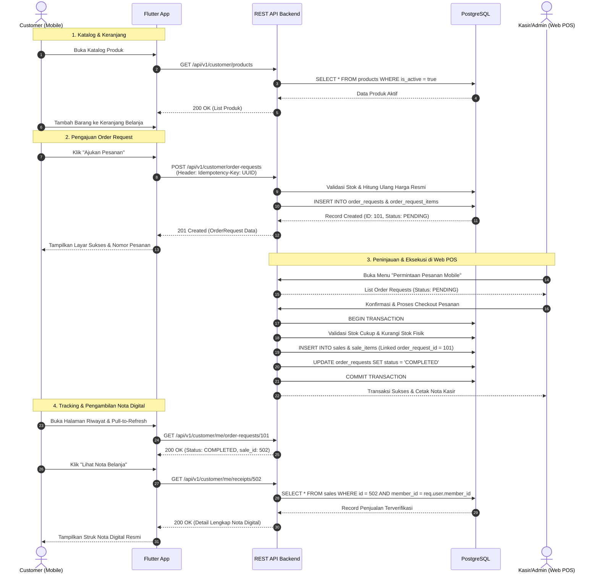
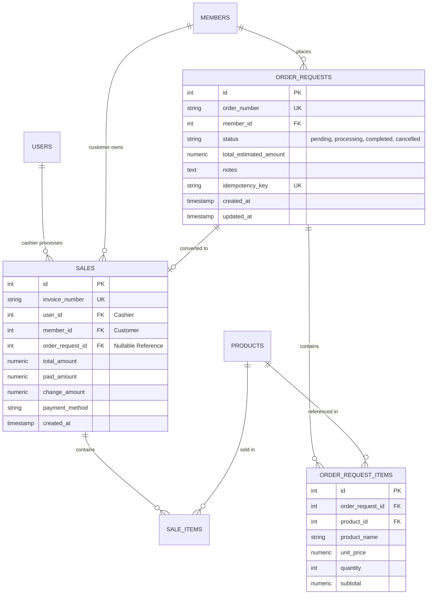
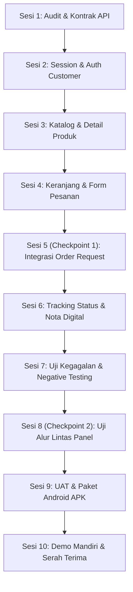

# PRODUCT REQUIREMENT DOCUMENT (PRD)
## Proyek M01 • Aplikasi Flutter Mobile Customer Toko
### Pendamping Sistem Web Kasir, Manajemen Stok & Loyalitas Toko (P01)

---

### Informasi Dokumen
- **Kode Proyek**: M01
- **Nama Proyek**: Mobile Customer Toko (Store Customer Mobile Companion)
- **Sistem Web Pendamping**: P01 • Aplikasi Kasir dan Stok Toko
- **Penanggung Jawab (PIC)**: Rizqon Nauval Zaloni
- **Institusi Penyelenggara**: PT Flash Tech Indonesia & BPVP Padang
- **Program**: On-the-Job Training (OJT) Fullstack & Mobile Developer 2026
- **Periode Pelaksanaan**: 2026 (10 Sesi Kerja Terarah)
- **Status Versi Dokumen**: v1.0.0 (Final Rilis Acuan)
- **Basis Referensi Dokumen**: 
  - `Kurikulum_Jobdesk_Mobile_Customer_Flutter_PostgreSQL_FlashTech_2026.pdf` (Halaman 01–08, 17–20)
  - `PRD_P01_Kasir_dan_Stok_Toko.md` (Spesifikasi Basis Web & Database)
  - Flutter Architectural Guide & PostgreSQL Constraints Standard

---

## 1. Ringkasan Eksekutif & Latar Belakang (Executive Summary)

### 1.1 Latar Belakang Masalah
Pada ekosistem ritel fisik dan toko kelontong modern (single outlet/location), operasional penjualan telah didukung oleh aplikasi Point of Sale (POS) berbasis Web (Proyek P01). Namun, interaksi dari sisi pelanggan (*customer*) masih menghadapi kendala operasional:
1. **Ketidakpastian Ketersediaan Barang**: Pelanggan harus datang langsung ke lokasi fisik toko hanya untuk memastikan apakah barang yang dicari tersedia dan berapa harga resminya saat ini.
2. **Antrean Penumpukan di Meja Kasir**: Pelanggan memilih barang secara langsung di lorong toko dan mendiktekan daftar belanjaan panjang di depan meja kasir, menyebabkan *bottleneck* antrean layanan.
3. **Ketiadaan Bukti Transaksi Digital**: Pelanggan seringkali kehilangan struk kertas fisik belanjaan mereka, sehingga kehilangan rekam jejak pengeluaran dan riwayat pembelian barang di toko.
4. **Keterbatasan Kanal Pemesanan Mandiri**: Belum tersedianya sarana bagi pelanggan terdaftar/anggota loyalitas untuk menyusun daftar belanja secara mandiri (*self-order request*) sebelum datang mengambil atau memfinalkan pembayaran di kasir.

### 1.2 Solusi Produk
Aplikasi **M01 • Mobile Customer Toko** hadir sebagai aplikasi mobile *native-performance* berbasis **Flutter (Android)** yang dirancang khusus untuk pelanggan toko. Aplikasi ini terhubung langsung secara *real-time* ke **PostgreSQL Backend** yang sama dengan panel web kasir/admin melalui **HTTPS REST API**.

Aplikasi ini memberikan kemampuan kepada customer untuk:
- Menjelajahi katalog produk aktif lengkap dengan harga resmi dan indikator ketersediaan stok.
- Mengelola keranjang belanja lokal secara interaktif dengan estimasi subtotal transparan.
- Mengajukan permintaan pesanan (*order request*) resmi ke toko dengan jaminan idempotensi request (*anti-double submission*).
- Memantau perkembangan status pesanan secara *real-time* (Menunggu Konfirmasi $\rightarrow$ Diproses $\rightarrow$ Selesai / Ditolak).
- Mengakses dan menyimpan arsip nota digital (*e-receipt*) resmi yang diterbitkan oleh kasir secara aman, terikat langsung dengan akun customer yang bersangkutan.

---

## 2. Tujuan & Sasaran Produk (Goals & Non-Goals)

### 2.1 Tujuan Produk (Product Goals)
1. **Self-Service Pre-Ordering**: Memfasilitasi pelanggan untuk menyusun keranjang belanja dan mengajukan pesanan awal sebelum mendatangi meja kasir.
2. **Katalog & Harga Transparan**: Menyajikan katalog produk aktif, pencarian instan, dan harga resmi yang tersinkronisasi langsung dengan basis data toko.
3. **Idempotensi & Keamanan Mutasi**: Menjamin tidak ada pengajuan pesanan ganda (*duplicate orders*) akibat jaringan lambat, retry otomatis, atau klik berulang dari pengguna melalui mekanisme `Idempotency-Key`.
4. **Isolasi Kepemilikan Data (*Strict Ownership*)**: Menjamin perlindungan privasi di mana setiap customer hanya dapat melihat, mengakses, dan menelusuri data pesanan serta nota miliknya sendiri.
5. **Harmonisasi Operasional Lintas Platform (Web & Mobile)**: Setiap pengajuan pesanan dari mobile langsung terbaca oleh kasir di panel web, dan setiap tindakan kasir (verifikasi pembayaran dan penerbitan nota) langsung terfleksi di layar mobile customer setelah disegarkan (*pull-to-refresh*).

### 2.2 Batasan Versi Awal (Out of Scope / Non-Goals)
Berdasarkan arahan kurikulum Flash Tech OJT 2026, batasan ketat diterapkan untuk menjaga integritas sistem kasir dan fokus pengerjaan:
- ❌ **TIDAK Mengurangi Stok Otomatis dari Mobile**: Permintaan pesanan (*Order Request*) dari customer **TIDAK langsung memotong stok barang** di database. Pemeriksaan stok fisik dan pemotongan stok resmi hanya terjadi saat kasir memfinalkan transaksi penjualan di web POS.
- ❌ **TIDAK Mengubah Harga atau Menetapkan Diskon**: Customer tidak memiliki hak mengubah nominal harga, menerapkan diskon sepihak, atau memanipulasi subtotal pesanan.
- ❌ **TIDAK Ada Pembayaran Otomatis / Payment Gateway**: Tidak ada integrasi kartu kredit, transfer bank otomatis, atau e-wallet API di aplikasi mobile. Pencatatan pembayaran tunai/resmi tetap dilakukan oleh kasir di meja pembayaran web.
- ❌ **TIDAK Menerbitkan Nota Penjualan Langsung**: Mobile hanya menampilkan nota penjualan (*Receipt/Sale*) yang telah diterbitkan dan disahkan oleh sistem kasir web.
- ❌ **TIDAK Menjadi Aplikasi Marketplace Multi-Toko**: Aplikasi didedikasikan secara privat untuk 1 ekosistem toko (single business outlet).
- ❌ **TIDAK Menyediakan Registrasi Publik Bebas / OTP SMS**: Akun customer disiapkan oleh admin/kasir toko melalui proses verifikasi keanggotaan terverifikasi (terintegrasi dengan data Member Toko).

---

## 3. Persona Pengguna & Matriks Hak Akses (RBAC)

### 3.1 Persona Pengguna
1. **Customer Toko (Mobile App User)**:
   - Pelanggan toko yang telah memiliki akun terverifikasi.
   - Menggunakan aplikasi Flutter untuk mencari barang, menyusun daftar belanja, mengirimkan permintaan pesanan, memantau status pesanan, dan melihat nota belanja miliknya.
2. **Kasir & Admin Toko (Web Panel User)**:
   - Pengelola toko yang mengoperasikan panel web P01.
   - Bertanggung jawab memvalidasi permintaan pesanan dari mobile, mengecek stok fisik, menerima pembayaran uang tunai, dan menerbitkan nota resmi penjualan.

### 3.2 Matriks Hak Akses (Mobile Customer vs Web Admin/Kasir)

| Fitur / Aksi | Customer (Mobile M01) | Kasir / Admin (Web P01) | Aturan Penegakan Keamanan |
| :--- | :---: | :---: | :--- |
| **Login Akun** | ✅ Ya (Role Customer) | ✅ Ya (Owner / Cashier) | Mobile menolak role admin/cashier; Web menolak role customer pada panel kasir |
| **Lihat Profil Sendiri** | ✅ Ya (`/me`) | ✅ Ya | Field update di mobile dibatasi (nama, no. HP, alamat) |
| **Lihat Katalog Produk** | ✅ Ya (Hanya Produk Aktif) | ✅ Ya (Seluruh Master Produk) | Mobile hanya membaca field publik (nama, kategori, harga, status ketersediaan) |
| **Kelola Master Produk & Stok**| ❌ Ditolak (403) | ✅ Ya | Perubahan harga & stok masuk mutlak kewenangan web |
| **Kelola Keranjang Belanja** | ✅ Ya (Lokal Mobile) | ❌ Tidak Relevan | Dihitung sementara di UI, divalidasi server saat submit |
| **Kirim Order Request** | ✅ Ya (`POST /order-requests`) | ❌ Tidak Relevan | Wajib menyertakan `Idempotency-Key` pada header |
| **Lihat Riwayat Pesanan** | ✅ Terbatas (Milik Sendiri) | ✅ Ya (Semua Pesanan Masuk) | Filter `customer_id` diambil dari token JWT, bukan dari request body |
| **Konfirmasi / Batalkan Pesanan**| ❌ Tidak Berwenang | ✅ Ya | Petugas toko menilai ketersediaan fisik sebelum memproses |
| **Proses Checkout & Bayar** | ❌ Ditolak | ✅ Ya | Eksekusi atomik pemotongan stok & pencatatan uang tunai di web |
| **Lihat Nota Belanja (Receipt)** | ✅ Terbatas (Nota Milik Sendiri)| ✅ Ya (Semua Transaksi Toko) | Server memvalidasi `Sale.member_id == req.user.member_id` |

> [!IMPORTANT]
> **Prinsip Keamanan Kepemilikan (No Trust on Client Input)**:
> Parameter `customer_id` atau `member_id` yang dikirim dari form/query mobile **TIDAK BOLEH** dipercaya oleh backend. Backend wajib mengekstrak identitas customer langsung dari JWT session yang telah diverifikasi melalui middleware autentikasi. Segala percobaan manipulasi ID akan menghasilkan kode respon `403 Forbidden` atau `404 Not Found`.

---

## 4. Alur Kerja Sistem & User Journey (System Workflow)

### 4.1 Arsitektur Komunikasi Lintas Platform
```
┌─────────────────────────────────┐           ┌─────────────────────────────────┐
│     Flutter Mobile (M01)        │           │        Web Admin / POS (P01)    │
│  - Presentation / UI Screens    │           │  - POS Cashier Terminal         │
│  - ViewModels (ChangeNotifier)  │           │  - Inventory & Stock Management │
│  - Repositories & HTTP Client   │           │  - Order Request Approval       │
└────────────────┬────────────────┘           └────────────────┬────────────────┘
                 │                                             │
                 │ HTTPS REST API                              │ HTTPS REST API
                 │ (/api/v1/customer/*)                        │ (/api/v1/*)
                 ▼                                             ▼
┌───────────────────────────────────────────────────────────────────────────────┐
│                    Express.js REST API Backend (Node.js)                      │
│   - Authentication & Role Middleware (JWT Verification)                       │
│   - Business Logic & Price Calculation Engine                                 │
│   - Idempotency Gatekeeper (Header: Idempotency-Key)                          │
│   - Ownership Validation Layer                                                │
└──────────────────────────────────────┬────────────────────────────────────────┘
                                       │
                                       │ Sequelize ORM
                                       ▼
┌───────────────────────────────────────────────────────────────────────────────┐
│                         PostgreSQL Database (Shared)                          │
│   - users / customer_sessions                                                 │
│   - products / stock_movements                                                │
│   - order_requests / order_request_items (Fitur Baru M01)                     │
│   - sales / sale_items / members (Tabel Eksisting P01)                        │
└───────────────────────────────────────────────────────────────────────────────┘
```

### 4.2 Sequence Diagram: Siklus Pemesanan hingga Nota Terbit


---

## 5. Spesifikasi Kebutuhan Fungsional (Functional Requirements)

### Modul 1: Autentikasi, Profil & Keamanan Sesi (AUTH)
- **FR-AUTH-01 (Customer Login)**: Customer dapat melakukan login menggunakan kombinasi `username` (atau nomor telepon terdaftar) dan `password`. Sistem memvalidasi bahwa akun memiliki hak akses peran customer. Jika kredensial admin/kasir digunakan, sistem menolak dengan pesan error yang jelas.
- **FR-AUTH-02 (Secure Token Storage)**: Token autentikasi (JWT) wajib disimpan di perangkat menggunakan `flutter_secure_storage` (Keystore pada Android). Token tidak boleh disimpan dalam plaintext di SharedPreferences.
- **FR-AUTH-03 (Session Expiration Handling - 401)**: Jika request ke backend menghasilkan status `401 Unauthorized` (token expired/invalid), aplikasi wajib secara otomatis menghapus session token lokal, membersihkan cache data sensitif di memori, dan mengarahkan navigasi pengguna kembali ke layar Login tanpa loop request tak terhingga.
- **FR-AUTH-04 (Get & Update Profil)**: Customer dapat melihat data profil dirinya (`GET /me`) dan memperbarui informasi personal terbatas (`PATCH /me`: nomor HP, alamat). Field kewenangan seperti `role`, `id`, `tier`, atau `points` diblokir dari perubahan sisi client.
- **FR-AUTH-05 (Clean Logout)**: Tombol logout wajib menghapus token otentikasi dari secure storage, mereset seluruh state ViewModel (keranjang, riwayat, profil), dan memastikan riwayat data Customer A tidak tertinggal saat Customer B login di perangkat yang sama.

### Modul 2: Katalog Produk & Informasi Stok (CATALOG)
- **FR-CAT-01 (Katalog Produk Aktif)**: Menampilkan daftar produk yang aktif (`is_active = true`) dari backend dengan sistem pagination (infinite scroll atau per page) dan indikator loading state yang jelas.
- **FR-CAT-02 (Pencarian Produk)**: Menyediakan input pencarian instan berbasis teks (*search query*) untuk mencari nama produk atau barcode/SKU dengan mekanisme debounce untuk meminimalkan beban request server.
- **FR-CAT-03 (Informasi Harga & Ketersediaan)**: Setiap kartu produk menampilkan nama barang, kategori, harga resmi terformat Rupiah (`Rp XX.XXX`), serta badge ketersediaan (*Tersedia* / *Stok Menipis* / *Habis*). Angka mutlak stok internal toko tidak diwajibkan tampil secara eksplisit guna melindungi kerahasiaan inventaris gudang.
- **FR-CAT-04 (Detail Produk)**: Menampilkan rincian deskripsi produk, satuan barang (pcs, botol, pack), kategori, dan tombol interaktif untuk menambahkan barang ke dalam keranjang belanja.
- **FR-CAT-05 (Pull-to-Refresh)**: Pengguna dapat menyegarkan katalog produk kapan saja untuk mendapatkan harga dan status ketersediaan paling mutakhir.

### Modul 3: Keranjang Belanja Interaktif (CART)
- **FR-CART-01 (Manajemen Item Keranjang)**: Customer dapat menambah barang, menambah/mengurangi kuantitas item, serta menghapus item dari keranjang belanja.
- **FR-CART-02 (Validasi Kuantitas Lokal)**: Kuantitas minimal per item adalah 1. Tombol minus (-) pada kuantitas 1 akan memicu dialog konfirmasi penghapusan item dari keranjang.
- **FR-CART-03 (Estimasi Subtotal Transparan)**: Layar keranjang menampilkan rincian harga per item, perkiraan subtotal, dan total estimasi belanja. Seluruh nilai kalkulasi di layar keranjang diberi keterangan eksplisit: *"Estimasi total belanja (akan divalidasi ulang saat pemrosesan pesanan)"*.
- **FR-CART-04 (Catatan Pesanan)**: Menyediakan kolom input catatan opsional (misal: *"Mohon pilihkan kemasan yang masih panjang masa kedaluwarsanya"*).

### Modul 4: Pengajuan Permintaan Pesanan & Idempotensi (ORDER REQUEST)
- **FR-ORD-01 (Validasi Sebelum Submit)**: Sistem memvalidasi keranjang tidak boleh kosong sebelum mengirim pesanan.
- **FR-ORD-02 (Penerapan Idempotency-Key)**: Setiap kali tombol "Ajukan Pesanan" ditekan, aplikasi menyertakan header HTTP `Idempotency-Key` bernilai unik (UUID v4) per aksi logis.
- **FR-ORD-03 (Proteksi Submit Ganda)**: Tombol "Ajukan Pesanan" otomatis terkunci (*disabled*) dan menampilkan indikator *loading* segera setelah ditekan, mencegah pengguna menekan tombol berulang kali saat proses jaringan berlangsung.
- **FR-ORD-04 (Penanganan Timeout Jaringan)**: Jika koneksi terputus atau timeout terjadi setelah payload terkirim, aplikasi **TIDAK membuat Idempotency-Key baru**, melainkan melakukan retry pengecekan dengan key yang sama untuk memastikan pesanan tidak terduplikasi di backend.
- **FR-ORD-05 (Server-side Recalculation)**: Backend menghitung ulang total harga berdasarkan harga master aktif di database saat request diterima. Jika terjadi perubahan harga/stok antara waktu masuk keranjang dan submit, sistem memberikan respon `409 Conflict` atau `422 Unprocessable Entity` disertai nilai terbaru agar pengguna dapat meninjau ulang.
- **FR-ORD-06 (Konfirmasi Keberhasilan)**: Jika sukses (`201 Created`), keranjang belanja lokal dikosongkan secara otomatis, dan pengguna diarahkan ke layar detail status pesanan yang memuat nomor referensi pesanan (`order_number`).

### Modul 5: Riwayat & Pelacakan Status Pesanan (TRACKING)
- **FR-TRK-01 (Daftar Riwayat Pesanan)**: Menampilkan seluruh daftar permintaan pesanan milik customer terautentikasi (`GET /me/order-requests`), diurutkan dari yang terbaru, dilengkapi badge status visual:
  - `PENDING` (Kuning): Menunggu ditinjau oleh kasir.
  - `PROCESSING` (Biru): Sedang disiapkan/diperiksa oleh petugas toko.
  - `COMPLETED` (Hijau): Selesai diproses & telah ditransaksikan di kasir (nota terbit).
  - `CANCELLED` (Merah): Dibatalkan oleh petugas (stok kosong atau pembatalan sah).
- **FR-TRK-02 (Detail Permintaan Pesanan)**: Menampilkan rincian barang yang dipesan, kuantitas, harga satuan yang disahkan server, total nominal resmi, catatan pesanan, dan jejak waktu pengajuan.
- **FR-TRK-03 (Pembaruan Status Real-Time)**: Customer dapat melakukan *pull-to-refresh* atau saat aplikasi beralih dari latar belakang (*resume*) untuk memuat status terbaru dari server.
- **FR-TRK-04 (Tautan ke Nota Resmi)**: Pada pesanan yang berstatus `COMPLETED`, sistem menyediakan tombol akses langsung "Lihat Nota Penjualan" yang menghubungkan pesanan tersebut dengan ID penjualan kasir (`sale_id`).

### Modul 6: Arsip & Tampilan Nota Penjualan Resmi (RECEIPT)
- **FR-RCP-01 (Akses Nota Digital)**: Customer dapat membuka nota penjualan resmi (`GET /me/receipts/{id}`) yang berkaitan dengan transaksinya.
- **FR-RCP-02 (Pemeriksaan Hak Kepemilikan Nota)**: Backend memastikan bahwa nota yang diminta berelasi langsung dengan akun customer yang sedang login. Akses terhadap nota milik customer lain ditolak dengan respon `403 Forbidden` atau `404 Not Found`.
- **FR-RCP-03 (Komponen Tampilan Nota)**: Antarmuka nota digital merefleksikan struk kasir resmi:
  - Header: Nama Toko, Alamat, Nomor Kontak.
  - Nomor Nota / Invoice, Tanggal & Jam Transaksi.
  - Nama Kasir yang melayani.
  - Rincian Item: Nama Produk, Kuantitas, Harga Satuan, Subtotal.
  - Ringkasan Finansial: Total Belanja, Diskon Poin Member (jika ada), Total Akhir, Nominal Bayar Tunai, Kembalian.
  - Informasi Perolehan Poin Belanja.
  - Catatan Kaki (*Footer Note*).
- **FR-RCP-04 (Immutability)**: Data nota yang ditampilkan bersifat permanen (*immutable historical snapshot*), tidak berubah meskipun master produk telah mengalami kenaikan harga di masa depan.

---

## 6. Penyesuaian Skema Database PostgreSQL (Backend Requirements)

Untuk mendukung integrasi Flutter Customer tanpa mengganggu stabilitas web POS yang sedang berjalan, dilakukan penyesuaian skema di database PostgreSQL bersama:



### 6.1 Tabel Baru: `order_requests`
Menyimpan header pengajuan pesanan dari aplikasi mobile customer.

| Kolom | Tipe Data | Constraint | Keterangan |
| :--- | :--- | :--- | :--- |
| `id` | `SERIAL / BIGINT` | `PRIMARY KEY` | Identitas unik record |
| `order_number` | `VARCHAR(50)` | `NOT NULL, UNIQUE` | Format acuan: `REQ-YYYYMMDD-XXXX` |
| `member_id` | `INTEGER` | `NOT NULL, REFERENCES members(id)` | Akun customer pemilik pesanan |
| `status` | `VARCHAR(20)` | `NOT NULL, DEFAULT 'pending'` | Enum: `pending`, `processing`, `completed`, `cancelled` |
| `total_estimated_amount`| `NUMERIC(15,2)` | `NOT NULL, >= 0` | Total nilai yang disahkan server |
| `notes` | `TEXT` | `NULLABLE` | Catatan khusus dari customer |
| `idempotency_key` | `VARCHAR(100)` | `NOT NULL, UNIQUE` | Mencegah duplicate submission |
| `cancellation_reason` | `VARCHAR(255)` | `NULLABLE` | Alasan jika pesanan ditolak petugas |
| `created_at` | `TIMESTAMPTZ` | `NOT NULL, DEFAULT NOW()` | Waktu pengajuan (ISO 8601) |
| `updated_at` | `TIMESTAMPTZ` | `NOT NULL, DEFAULT NOW()` | Waktu perubahan terakhir |

### 6.2 Tabel Baru: `order_request_items`
Menyimpan rincian item per pesanan mobile.

| Kolom | Tipe Data | Constraint | Keterangan |
| :--- | :--- | :--- | :--- |
| `id` | `SERIAL / BIGINT` | `PRIMARY KEY` | Identitas unik item |
| `order_request_id` | `INTEGER` | `NOT NULL, REFERENCES order_requests(id) ON DELETE CASCADE`| Relasi ke header pesanan |
| `product_id` | `INTEGER` | `NOT NULL, REFERENCES products(id)` | Produk yang dipesan |
| `product_name` | `VARCHAR(150)`| `NOT NULL` | Snapshot nama produk saat dipesan |
| `unit_price` | `NUMERIC(15,2)` | `NOT NULL, >= 0` | Snapshot harga per unit saat order diajukan |
| `quantity` | `INTEGER` | `NOT NULL, CHECK (quantity > 0)` | Kuantitas belanjaan |
| `subtotal` | `NUMERIC(15,2)` | `NOT NULL, >= 0` | `unit_price * quantity` |

### 6.3 Penyesuaian Tabel Eksisting: `sales`
- Penambahan kolom: `order_request_id INTEGER NULLABLE REFERENCES order_requests(id) ON DELETE SET NULL`.
- Kolom ini memastikan bahwa saat kasir web memproses pesanan mobile menjadi transaksi penjualan kasir, relasinya tercatat secara langsung dan status pesanan otomatis berganti menjadi `completed`.

---

## 7. Spesifikasi Kontrak REST API (API Contract Specification)

Base URL: `https://api.staging-toko.flashtech.id`  
Prefix Route Customer: `/api/v1/customer`

### 7.1 Autentikasi: `POST /api/v1/customer/auth/login`
**Tujuan**: Login pengguna mobile customer.

**Request Body**:
```json
{
  "username": "customer_budi",
  "password": "PasswordRahasia123!"
}
```

**Response `200 OK`**:
```json
{
  "success": true,
  "message": "Login berhasil",
  "data": {
    "token": "eyJhbGciOiJIUzI1NiIsInR5cCI6IkpXVCJ9...",
    "token_type": "Bearer",
    "expires_in": 86400,
    "user": {
      "id": 12,
      "member_id": 5,
      "member_code": "MBR-0005",
      "name": "Budi Santoso",
      "phone": "081234567890",
      "tier": "Silver",
      "points": 150
    }
  }
}
```

---

### 7.2 Profil: `GET /api/v1/customer/me`
**Header**: `Authorization: Bearer <TOKEN>`

**Response `200 OK`**:
```json
{
  "success": true,
  "data": {
    "id": 12,
    "member_id": 5,
    "member_code": "MBR-0005",
    "name": "Budi Santoso",
    "phone": "081234567890",
    "email": "budi@example.com",
    "address": "Jl. Sudirman No. 45, Padang",
    "tier": "Silver",
    "points": 150
  }
}
```

---

### 7.3 Katalog Produk: `GET /api/v1/customer/products`
**Query Parameters**:
- `page`: nomor halaman (default: `1`)
- `limit`: jumlah data per halaman (default: `20`)
- `search`: string pencarian nama / barcode (opsional)
- `category`: filter kategori produk (opsional)

**Response `200 OK`**:
```json
{
  "success": true,
  "data": [
    {
      "id": 101,
      "barcode": "8992761011110",
      "name": "Beras Ramos Super 5kg",
      "category": "Sembako",
      "price": "68000.00",
      "unit": "sak",
      "is_available": true,
      "image_url": "https://api.staging-toko.flashtech.id/uploads/beras.jpg"
    },
    {
      "id": 102,
      "barcode": "8991002102221",
      "name": "Minyak Goreng Sania 2L",
      "category": "Sembako",
      "price": "34500.00",
      "unit": "pouch",
      "is_available": true,
      "image_url": "https://api.staging-toko.flashtech.id/uploads/minyak.jpg"
    }
  ],
  "pagination": {
    "current_page": 1,
    "total_pages": 4,
    "total_items": 65,
    "limit": 20
  }
}
```

---

### 7.4 Submit Order Request: `POST /api/v1/customer/order-requests`
**Headers**:
- `Authorization: Bearer <TOKEN>`
- `Idempotency-Key: 9b1deb4d-3b7d-4bad-9bdd-2b0d7b3dcb6d`

**Request Body**:
```json
{
  "notes": "Tolong pilihkan yang kemasan rapi dan tidak bocor.",
  "items": [
    {
      "product_id": 101,
      "quantity": 2
    },
    {
      "product_id": 102,
      "quantity": 1
    }
  ]
}
```

**Response `201 Created`**:
```json
{
  "success": true,
  "message": "Permintaan pesanan berhasil dikirim ke kasir toko",
  "data": {
    "id": 88,
    "order_number": "REQ-20261110-0088",
    "status": "pending",
    "total_estimated_amount": "170500.00",
    "notes": "Tolong pilihkan yang kemasan rapi dan tidak bocor.",
    "created_at": "2026-11-10T10:15:30.000Z",
    "items_count": 2,
    "items": [
      {
        "product_id": 101,
        "product_name": "Beras Ramos Super 5kg",
        "unit_price": "68000.00",
        "quantity": 2,
        "subtotal": "136000.00"
      },
      {
        "product_id": 102,
        "product_name": "Minyak Goreng Sania 2L",
        "unit_price": "34500.00",
        "quantity": 1,
        "subtotal": "34500.00"
      }
    ]
  }
}
```

**Response Error (Idempotent Hit / Stale Data `409 Conflict`)**:
```json
{
  "success": false,
  "error": {
    "code": "STALE_PRODUCT_PRICE",
    "message": "Harga satu atau lebih produk telah berubah. Silakan tinjau kembali keranjang Anda.",
    "field_errors": {
      "items[1].product_id": "Harga terbaru Rp 36.000 (sebelumnya Rp 34.500)"
    },
    "request_id": "req-98af8124"
  }
}
```

---

### 7.5 Daftar & Detail Order Request: `GET /api/v1/customer/me/order-requests[/{id}]`
**Header**: `Authorization: Bearer <TOKEN>`

**Response `200 OK` (Detail `/{id}`)**:
```json
{
  "success": true,
  "data": {
    "id": 88,
    "order_number": "REQ-20261110-0088",
    "status": "completed",
    "total_estimated_amount": "170500.00",
    "notes": "Tolong pilihkan yang kemasan rapi dan tidak bocor.",
    "sale_id": 312,
    "created_at": "2026-11-10T10:15:30.000Z",
    "updated_at": "2026-11-10T10:30:12.000Z",
    "items": [
      {
        "id": 145,
        "product_id": 101,
        "product_name": "Beras Ramos Super 5kg",
        "unit_price": "68000.00",
        "quantity": 2,
        "subtotal": "136000.00"
      },
      {
        "id": 146,
        "product_id": 102,
        "product_name": "Minyak Goreng Sania 2L",
        "unit_price": "34500.00",
        "quantity": 1,
        "subtotal": "34500.00"
      }
    ]
  }
}
```

---

### 7.6 Nota Penjualan Resmi: `GET /api/v1/customer/me/receipts/{id}`
**Header**: `Authorization: Bearer <TOKEN>`

**Response `200 OK`**:
```json
{
  "success": true,
  "data": {
    "id": 312,
    "invoice_number": "INV-20261110-0312",
    "transaction_date": "2026-11-10T10:30:12.000Z",
    "cashier_name": "Siti Rahma",
    "store_info": {
      "name": "Toko Berkah OJT BPVP",
      "address": "Jl. Raya Padang No. 12, Padang",
      "phone": "0751-123456"
    },
    "member": {
      "member_code": "MBR-0005",
      "name": "Budi Santoso",
      "points_earned": 17,
      "current_points": 167
    },
    "items": [
      {
        "product_name": "Beras Ramos Super 5kg",
        "unit_price": "68000.00",
        "quantity": 2,
        "subtotal": "136000.00"
      },
      {
        "product_name": "Minyak Goreng Sania 2L",
        "unit_price": "34500.00",
        "quantity": 1,
        "subtotal": "34500.00"
      }
    ],
    "financials": {
      "subtotal": "170500.00",
      "discount_amount": "0.00",
      "final_total": "170500.00",
      "payment_amount": "200000.00",
      "change_amount": "29500.00",
      "payment_method": "Cash"
    },
    "footer_message": "Terima kasih telah berbelanja di Toko Berkah. Barang yang sudah dibeli tidak dapat ditukar/dikembalikan."
  }
}
```

---

## 8. Arsitektur Teknis Aplikasi Flutter (Client Architecture)

### 8.1 Pola Arsitektur (Separation of Concerns)
Aplikasi mengadopsi standar arsitektur resmi Flutter: **Service $\rightarrow$ Repository $\rightarrow$ ViewModel (ChangeNotifier) $\rightarrow$ View (Widget)**.

```
lib/
├── core/
│   ├── config/             # Environment base URL & timeout configuration
│   ├── network/            # ApiClient (http wrappers, error mapping, headers)
│   ├── storage/            # SecureTokenStorage (flutter_secure_storage)
│   ├── session/            # SessionManager (session lifecycle, clear on logout)
│   ├── constants/          # AppColors, ApiEndpoints, AppStrings
│   ├── utils/              # CurrencyFormatter (IDR), DateFormatter (WIB)
│   └── errors/             # Failure models & ApiException classes
├── features/
│   ├── auth/               # Model, Service, Repo, AuthViewModel, LoginView
│   ├── catalog/            # ProductModel, CatalogRepo, CatalogViewModel, CatalogView, ProductDetailView
│   ├── cart/               # CartItemModel, CartViewModel, CartView
│   ├── order_request/      # OrderRequestModel, OrderRepo, OrderViewModel, OrderDetailView, OrderHistoryView
│   ├── receipt/            # ReceiptModel, ReceiptRepo, ReceiptViewModel, ReceiptDetailView
│   └── profile/            # ProfileViewModel, ProfileView
└── main.dart               # MultiProvider setup, Router configuration
```

### 8.2 Konvensi Status Antarmuka (UI State Pattern)
Setiap ViewModel mengelola 5 status dasar yang dipetakan langsung ke komponen UI:
1. `initial`: Kondisi sebelum ada data dimuat.
2. `loading`: Menampilkan `CircularProgressIndicator` atau *skeleton loading*.
3. `success`: Menampilkan data utama dengan dukungan `RefreshIndicator` (*pull-to-refresh*).
4. `empty`: Menampilkan ilustrasi dan pesan informatif saat data kosong (misal: *"Keranjang masih kosong"* atau *"Belum ada riwayat pesanan"*).
5. `error`: Menampilkan pesan kesalahan ramah pengguna dan tombol **"Coba Lagi" (Retry)**.

### 8.3 Kunci Dependensi Terpilih (`pubspec.yaml`)
- `http: ^1.2.0` : HTTP Client standar industri untuk komunikasi REST API.
- `flutter_secure_storage: ^9.0.0` : Enkripsi penyimpanan token JWT pada perangkat fisik.
- `provider: ^6.1.1` : State management reaktif berbasis `ChangeNotifier`.
- `intl: ^0.19.0` : Format tanggal ISO 8601 ke zona waktu Asia/Jakarta dan format mata uang Rupiah.

---

## 9. Non-Functional Requirements (NFR)

1. **Keamanan Data & Privasi**:
   - Komunikasi data wajib menggunakan protokol HTTPS terenkripsi.
   - Tidak ada token JWT, password, atau kredensial database yang dicatat dalam log konsol (*logging security*).
   - Seluruh token dan data sensitif di memori dibersihkan saat sesi berakhir.
2. **Kinerja Antarmuka (UI Performance)**:
   - Rendering UI berjalan mulus pada target 60 FPS di perangkat Android fisik.
   - Input teks pencarian menggunakan teknik *debouncing* (350–500 ms) untuk mencegah pemborosan panggilan jaringan.
3. **Ketahanan Jaringan (Network Resilience)**:
   - Request timeout ditetapkan 10 detik. Jika terjadi kegagalan jaringan, aplikasi menampilkan umpan balik visual yang jelas dan tidak *freeze* atau *crash*.
   - Aksi pengajuan pesanan terlindungi oleh `Idempotency-Key` sehingga tidak menghasilkan pesanan berulang saat terjadi lonjakan latensi.
4. **Kompabilitas Perangkat**:
   - Target sistem operasi: Android 8.0 (Oreo / API Level 26) ke atas hingga Android 14+.

---

## 10. Matriks Skenario Pengujian & Acceptance Criteria

### 10.1 Skenario Pengujian Khusus M01 (R01 – R04)

| Kode Uji | Skenario Pengujian | Langkah Pengujian | Hasil yang Diharapkan (Acceptance Criteria) |
| :--- | :--- | :--- | :--- |
| **R01** | **Harga/Stok berubah saat item di keranjang** | 1. Customer memasukkan barang A (Rp 10.000) ke keranjang.<br/>2. Admin mengubah harga barang A di web menjadi Rp 12.000.<br/>3. Customer menekan "Ajukan Pesanan". | Server menolak dengan respon status `409 Conflict`. UI menampilkan notifikasi harga baru dan meminta customer melakukan konfirmasi ulang. |
| **R02** | **Timeout setelah submit, lalu coba lagi** | 1. Customer submit pesanan dengan key unik.<br/>2. Koneksi dijeda/timeout setelah request sampai ke server.<br/>3. Pengguna menekan tombol coba lagi dengan key yang sama. | Server mendeteksi key yang sama dan mengembalikan hasil transaksi yang telah tersimpan sebelumnya tanpa membuat baris pesanan baru. |
| **R03** | **Customer A mencoba membuka pesanan/nota Customer B** | 1. Customer A login.<br/>2. Mencoba memanggil endpoint `/me/order-requests/{id_milik_B}` atau `/me/receipts/{id_milik_B}`. | Server menolak dengan status `403 Forbidden` atau `404 Not Found`. Data pesanan/nota Customer B tidak pernah bocor ke UI atau cache Customer A. |
| **R04** | **Admin memproses pesanan di web POS** | 1. Pesanan diajukan dari mobile (Status: PENDING).<br/>2. Admin di web POS membuka pesanan dan memfinalkannya menjadi transaksi penjualan.<br/>3. Customer melakukan pull-to-refresh di mobile. | Status di aplikasi mobile berubah menjadi `COMPLETED`, dan muncul tautan aktif untuk membuka nota digital terkait. |

### 10.2 Skenario Pengujian Wajib Integrasi Lintas Aplikasi (I01 – I10)

| Kode Uji | Kasus Pengujian | Bukti Penerimaan (Acceptance Criteria) |
| :--- | :--- | :--- |
| **I01** | Admin mengubah data terkait Customer A di web | Mobile A memuat data terbaru setelah refresh; Customer B tidak dapat membaca data A. |
| **I02** | Aksi pengajuan dari mobile berhasil | Record pesanan tersimpan konsisten di database PostgreSQL dan langsung muncul pada panel admin web. |
| **I03** | Upaya manipulasi ID/Role dari request body/query | Backend menolak request manipulasi; UI tidak menerima atau mengekspos data yang dilarang. |
| **I04** | Sesi token kedaluwarsa atau aksi logout | Respon 401 otomatis mengarahkan ke halaman login; token dan cache dibersihkan; tidak ada looping request. |
| **I05** | Timeout setelah submit atau klik tombol berulang | Tidak terjadi duplikasi data pesanan di PostgreSQL; tombol submit terkunci saat proses berjalan. |
| **I06** | Data master berubah saat form/layar terbuka | Respon 409 / stale data ditangani dengan benar; pengguna diminta meninjau ulang perubahan terbaru. |
| **I07** | Koneksi internet terputus, respon 5xx, atau data kosong | State antarmuka jelas (loading/empty/error); retry terkontrol; data keranjang tidak hilang sia-sia. |
| **I08** | Pergantian akun (Logout A $\rightarrow$ Login B) | State B bersih dari data A; tidak ada kebocoran dokumen nota atau pesanan lama di memori/cache. |
| **I09** | Build Android terpasang di perangkat fisik uji | Konfigurasi jaringan dan base URL staging benar; HTTPS dapat diakses; seluruh alur inti berjalan lancar. |
| **I10** | Regresi setelah migrasi database PostgreSQL | Master produk, stok kasir, dan laporan di web tetap berjalan akurat pasca penambahan tabel baru. |

---

## 11. Rencana Pelaksanaan OJT (10 Sesi Harian Terarah)



- **Sesi 1 • Audit Kesiapan & Jembatan Flutter**:
  - Memeriksa kesiapan PostgreSQL, dependensi Flutter, dan finalisasi spesifikasi kontrak API bersama mentor. Menghubungkan Flutter ke endpoint *health check*.
- **Sesi 2 • Sesi & Profil Customer**:
  - Implementasi HTTP Client, Secure Token Storage, endpoint login, `/me`, route guard, dan auto-logout 401.
- **Sesi 3 • Katalog & Detail Produk**:
  - Membangun katalog produk aktif, integrasi pagination, search bar ber-debounce, dan penanganan state loading/empty/error.
- **Sesi 4 • Keranjang Belanja & Form Aksi Customer**:
  - Membangun state keranjang interaktif, validasi kuantitas item, kalkulasi estimasi subtotal, dan dialog konfirmasi pemesanan.
- **Sesi 5 • Checkpoint 1: Integrasi Pengajuan Pesanan**:
  - Menghubungkan submit pesanan ke `POST /order-requests` dengan header `Idempotency-Key`. Verifikasi bahwa pesanan sukses tercatat di database PostgreSQL dan tampil di panel web kasir.
- **Sesi 6 • Riwayat, Status & Dokumen Nota**:
  - Mengintegrasikan daftar riwayat pesanan, status tracking, serta modul pembacaan nota penjualan resmi (`GET /me/receipts/{id}`) dengan dukungan *pull-to-refresh*.
- **Sesi 7 • Penanganan Kegagalan & Isolasi Akses**:
  - Pengujian skenario negatif: token expired, stale data 409, pencegahan IDOR (R03), timeout recovery (R02), dan pergantian akun bersih.
- **Sesi 8 • Checkpoint 2: Alur Lintas Panel (End-to-End)**:
  - Demonstrasi menyeluruh: Pengajuan di mobile $\rightarrow$ Konfirmasi & Checkout di web kasir $\rightarrow$ Pembaruan status & penerbitan nota di mobile.
- **Sesi 9 • UAT & Pembuatan Paket Android**:
  - Menjalankan skenario UAT bersama mentor, analisis performa kode (*flutter analyze*), pengujian integrasi otomatis, serta kompilasi APK rilis staging.
- **Sesi 10 • Demo & Serah Terima**:
  - Presentasi demonstrasi aplikasi secara mandiri di hadapan mentor/penguji, serah terima kode sumber bersih, dokumen kontrak API, serta catatan hasil uji.

---

## 12. Lembar Penetapan & Pengesahan

Ditetapkan di: **Padang**  
Pada tanggal: **____________________ 2026**

<br/>

| Pimpinan PT Flash Tech Indonesia | Mentor / Pembimbing OJT | Peserta OJT (PIC M01) |
| :---: | :---: | :---: |
| <br/><br/><br/>_______________________________ | <br/><br/><br/>_______________________________ | <br/><br/><br/>**Rizqon Nauval Zaloni** |
| NIP/Jabatan: __________________ | NIP/Jabatan: __________________ | NIM/No. Peserta: ______________ |

*(Dokumen ini merupakan acuan resmi pelaksanaan dan penilaian proyek mobile OJT 2026 PT Flash Tech Indonesia bekerjasama dengan BPVP Padang)*

